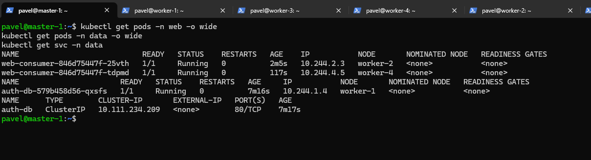
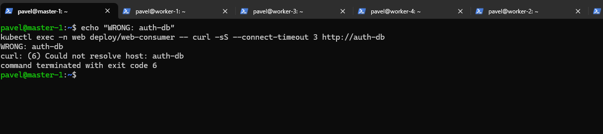
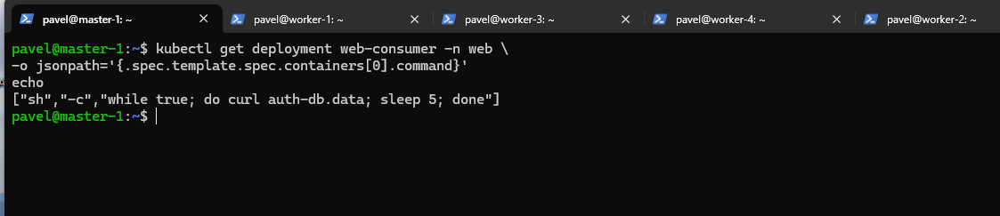
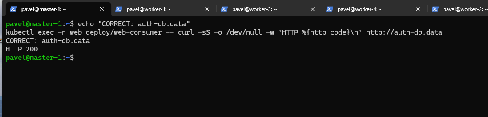

# Домашнее задание к занятию «Troubleshooting»

## Цель

Выявить и устранить неисправность, из-за которой приложение `web-consumer` не может подключиться к `auth-db`.

---

## Исходный манифест

Приложение было установлено из манифеста Netology:

```text
https://raw.githubusercontent.com/netology-code/kuber-homeworks/main/3.5/files/task.yaml
```

Перед установкой были созданы необходимые namespace:

```bash
kubectl create namespace web
kubectl create namespace data
```

После этого применён исходный манифест:

```bash
kubectl apply -f https://raw.githubusercontent.com/netology-code/kuber-homeworks/main/3.5/files/task.yaml
```

---

# 1. Проверка состояния приложения

Для начала проверил Pod'ы и Service:

```bash
kubectl get pods -n web -o wide
kubectl get pods -n data -o wide
kubectl get svc -n data
```

После исправлений Pod'ы находятся в состоянии `Running`.

`web-consumer` работает в namespace:

```text
web
```

`auth-db` и Service `auth-db` находятся в namespace:

```text
data
```



---

# 2. Дополнительная проблема с образом

При первом запуске `web-consumer` не смог запуститься и находился в состоянии:

```text
ImagePullBackOff
```

В исходном манифесте использовался образ:

```text
radial/busyboxplus:curl
```

В моём окружении данный образ не удалось скачать.

Поэтому для продолжения диагностики образ был заменён на:

```text
curlimages/curl:8.23.0
```

Команда:

```bash
kubectl set image deployment/web-consumer \
  busybox=curlimages/curl:8.23.0 \
  -n web
```

После этого Pod'ы `web-consumer` успешно запустились и появилась возможность проверить основную проблему задания.

---

# 3. Поиск основной проблемы

После запуска `web-consumer` проверил его логи:

```bash
kubectl logs -n web -l app=web-consumer
```

В логах появилась ошибка:

```text
curl: (6) Could not resolve host: auth-db
```

Для дополнительной проверки выполнил:

```bash
kubectl exec -n web deploy/web-consumer -- \
curl -sS --connect-timeout 3 http://auth-db
```

Результат:

```text
curl: (6) Could not resolve host: auth-db
command terminated with exit code 6
```



---

# 4. Причина проблемы

`web-consumer` находится в namespace:

```text
web
```

а Service `auth-db` находится в другом namespace:

```text
data
```

В Deployment использовалась команда:

```bash
curl auth-db
```

Короткое DNS-имя `auth-db` используется для обращения к Service внутри того же namespace.

Но `auth-db` находится в другом namespace, поэтому необходимо указать namespace в DNS-имени:

```text
auth-db.data
```

Полное DNS-имя Service также может выглядеть так:

```text
auth-db.data.svc.cluster.local
```

---

# 5. Исправление

Команда в Deployment была изменена с:

```bash
while true; do curl auth-db; sleep 5; done
```

на:

```bash
while true; do curl auth-db.data; sleep 5; done
```

Для изменения Deployment использовалась команда:

```bash
kubectl patch deployment web-consumer -n web --type='strategic' -p '
{
  "spec": {
    "template": {
      "spec": {
        "containers": [
          {
            "name": "busybox",
            "command": [
              "sh",
              "-c",
              "while true; do curl auth-db.data; sleep 5; done"
            ]
          }
        ]
      }
    }
  }
}'
```

После изменения проверил Deployment:

```bash
kubectl get deployment web-consumer -n web \
-o jsonpath='{.spec.template.spec.containers[0].command}'
echo
```

Результат:

```text
["sh","-c","while true; do curl auth-db.data; sleep 5; done"]
```



---

# 6. Проверка результата

Для проверки подключения выполнил:

```bash
kubectl exec -n web deploy/web-consumer -- \
curl -s -o /dev/null -w 'HTTP %{http_code}\n' http://auth-db.data
```

Результат:

```text
HTTP 200
```

Это означает, что `web-consumer` успешно подключается к Service `auth-db`.



Также при обычном запросе:

```bash
kubectl exec -n web deploy/web-consumer -- curl -s http://auth-db.data
```

была получена страница:

```text
Welcome to nginx!
```

---

# Итог

Была выявлена основная причина неисправности:

```text
web-consumer
namespace: web

        ↓

curl auth-db
        ❌

auth-db
namespace: data
```

Service находился в другом namespace, поэтому короткое DNS-имя `auth-db` не разрешалось.

После изменения адреса:

```text
auth-db
```

на:

```text
auth-db.data
```

связь была восстановлена:

```text
web-consumer
namespace: web

        ↓

auth-db.data
        ✅ HTTP 200

auth-db
namespace: data
```

В результате:

- `web-consumer` работает;
- `auth-db` работает;
- DNS-имя Service корректно разрешается;
- запрос к `auth-db.data` возвращает `HTTP 200`;
- проблема устранена.

---

## Скриншоты

```text
screenshots/
├── 01-pods-services.png
├── 02-dns-error.png
├── 03-success-http-200.png
└── 04-fixed-deployment.png
```

## Исходный манифест

Манифест задания:

```text
https://raw.githubusercontent.com/netology-code/kuber-homeworks/main/3.5/files/task.yaml
```